# Crosses 35 Dual — vergilcw's ZMK config

 

Personal [ZMK](https://zmk.dev) firmware for a **wireless Crosses 35 split keyboard with two trackballs**
(3×5+3 keys, nice!nano v2 controllers, PMW3610 sensors, 128×32 OLEDs). Forked from
[HeeTuic/zmk-for-crosses35-dual](https://github.com/HeeTuic/zmk-for-crosses35-dual).

> ⚠️ Only for the **MIAOMIAO / HeeTuic modified-PCB** Crosses 35 dual-trackball. Pinouts differ from the
> original [GGGW Crosses](https://github.com/Good-Great-Grand-Wonderful/crosses); don't flash this on other boards.

- **Right half** — central: connects to the computer over USB/Bluetooth, runs ZMK Studio, trackball = pointer
  (rotated 45° counterclockwise; slow "snipe" on Raise).
- **Left half** — peripheral: trackball = vertical scroll wheel (horizontal on Raise, a full pointer while holding `V`).

---

## 🗺️ Keymap



*Rendered by [keymap-drawer](https://github.com/caksoylar/keymap-drawer) via GitHub Actions on every change to
`config/crosses.keymap` — always matches the firmware source.*

| Layer | Reach | What's there |
| --- | --- | --- |
| **Base** | — | QWERTY, `;` on the right pinky, mod-taps on the bottom row (Alt/Shift on Z X . /), thumbs: Tab/Mouse · Bspc/Shift · Del/Lower — Ret/Ctrl · Space/Raise · Gui. **J+K together = Esc** ("just kidding") |
| **Lower** | hold left-inner thumb, `V` or `M` | Print Screen (W), Bluetooth profiles 4/3 (E/R) and BT clear (Y), media prev/play/next (above vol−/mute/vol+), volume + brightness, F-keys in numpad order (F7–F9 / F4–F6 / F1–F3, F10–F12 on the pinky), USB/BT toggle. **Both trackballs scroll vertically (unrotated).** |
| **Raise** | hold right-middle thumb | Symbols on the left, numpad on the right with `:` above the `-` (type times without leaving Raise), mouse clicks under the left ring/middle/index fingers (as on Mouse). **Right trackball snipes; left ball scrolls horizontally.** |
| **LMouse** | hold `C` | Left-handed mouse: left trackball = pointer, left thumbs = M3/M2/M1, right half = Home/↑/End, ←/↓/→, PgUp/PgDn (pinky) and L/R/M click (under J K L), Ctrl and Shift on the right thumbs; hold `V` as well to scroll (other keys off) |
| **RMouse** | hold `,` | Right trackball = pointer, right thumbs = left/right/middle click, left half = PgUp/PgDn (pinky), Home/↑/End, ←/↓/→ and clicks as on the Mouse layer (no Bluetooth keys), Shift and Ctrl on the left thumbs; hold `M` as well to scroll (other keys off) |
| **Mouse** | hold left-outer thumb | Bluetooth profiles 0–2, PgUp/PgDn on both pinkies, Home/↑/End and arrows, mouse buttons, brackets/parens, `'`/`"` on the right pinky, Studio unlock |

The keymap mirrors my [Crosses 36](https://github.com/vergilcw/zmk-for-crosses36) (single-trackball) board's inner
block, minus its outer pinky columns. Trackball rotation/layer behaviour is in the keymap file
(see [docs/hardware.md](docs/hardware.md)); the left ball is always a scroll wheel.

---

## 🛠️ Changing the keymap

### Source of truth: `config/crosses.keymap`
Edit, push, and GitHub Actions builds the firmware and redraws the diagram above. See
[docs/keymap-workflow.md](docs/keymap-workflow.md).

### ZMK Studio (live remapping, no flashing)
Open [zmk.studio](https://zmk.studio/) in a Chromium browser (or the desktop app), connect the **right half** over
USB, press **Studio unlock** (Mouse layer → N). Changes apply instantly and are saved on the keyboard.

> Studio-saved layers override the compiled keymap, even after re-flashing. Codify anything you want to keep
> (`scripts/studio_dump.py` exports the live keymap) and use *Restore Stock Settings* after flashing.

### Keymap Editor (web GUI that commits to GitHub)
[Keymap Editor](https://nickcoutsos.github.io/keymap-editor/) can edit `config/crosses.keymap` — including
combos, macros and hold-tap behaviors — and commits straight to this repo, triggering a build.

---

## 🚀 Flashing

Full guide: [docs/flashing.md](docs/flashing.md).

Commands are for fish; the build must be green first (`gh run list -L 3`).

```fish
# 1. Download the firmware from the latest successful build on main
set run (gh run list --workflow build.yml --branch main --status success -L 1 --json databaseId --jq '.[0].databaseId')
rm -rf /tmp/crosses-fw; gh run download $run -D /tmp/crosses-fw
ls /tmp/crosses-fw/firmware   # crosses_35_right.uf2  crosses_35_left.uf2  settings_reset-nice_nano-zmk.uf2

# 2. Plug in ONE half and double-tap its reset button; a NICENANO drive appears
ls /run/media/$USER/NICENANO

# 3. Copy the matching file (the board reboots by itself; a "copy failed" message at the end is normal)
cp /tmp/crosses-fw/firmware/crosses_35_right.uf2 /run/media/$USER/NICENANO/   # right half
# ...then, with the left half in the bootloader instead:
cp /tmp/crosses-fw/firmware/crosses_35_left.uf2 /run/media/$USER/NICENANO/    # left half
```

Keymap/trackball changes need only the right half. If the halves stop pairing, flash `settings_reset-nice_nano-zmk.uf2`
to both, then re-flash both (this wipes Bluetooth bonds). After flashing, run *Restore Stock Settings* in ZMK Studio
if you ever saved Studio edits.

---

## 📚 Project docs

- [docs/plan.md](docs/plan.md) — roadmap and status (typing fixes, axis-locked scrolling, mic-mute key,
  connectivity hardening)
- [docs/hardware.md](docs/hardware.md) — how the halves, trackballs and ZMK modules fit together
- [docs/knowledge-base.md](docs/knowledge-base.md) — findings, gotchas, decisions
- [AGENTS.md](AGENTS.md) — instructions for AI coding agents working in this repo

---

## 🙏 Credits

- [HeeTuic](https://github.com/HeeTuic) — modified Crosses PCB, original firmware
  ([zmk-for-crosses35-dual](https://github.com/HeeTuic/zmk-for-crosses35-dual),
  [zmk-for-crosses](https://github.com/HeeTuic/zmk-for-crosses), [cb-zmk-keebs](https://github.com/HeeTuic/cb-zmk-keebs))
- [Good-Great-Grand-Wonderful](https://github.com/Good-Great-Grand-Wonderful/crosses) — Crosses design
- [efogdev](https://github.com/efogdev) (PMW3610 driver, report-rate limit), [badjeff](https://github.com/badjeff),
  [caksoylar](https://github.com/caksoylar) (keymap-drawer), and the [ZMK](https://github.com/zmkfirmware/zmk) project
